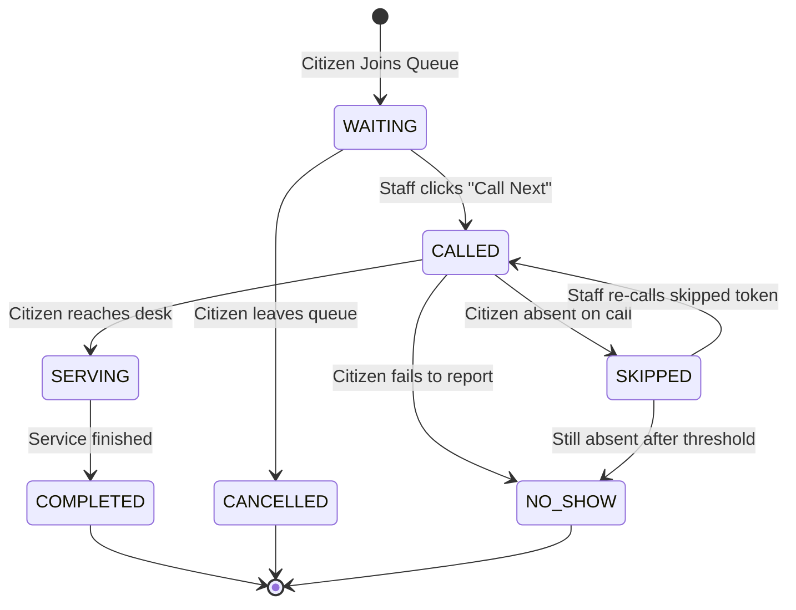
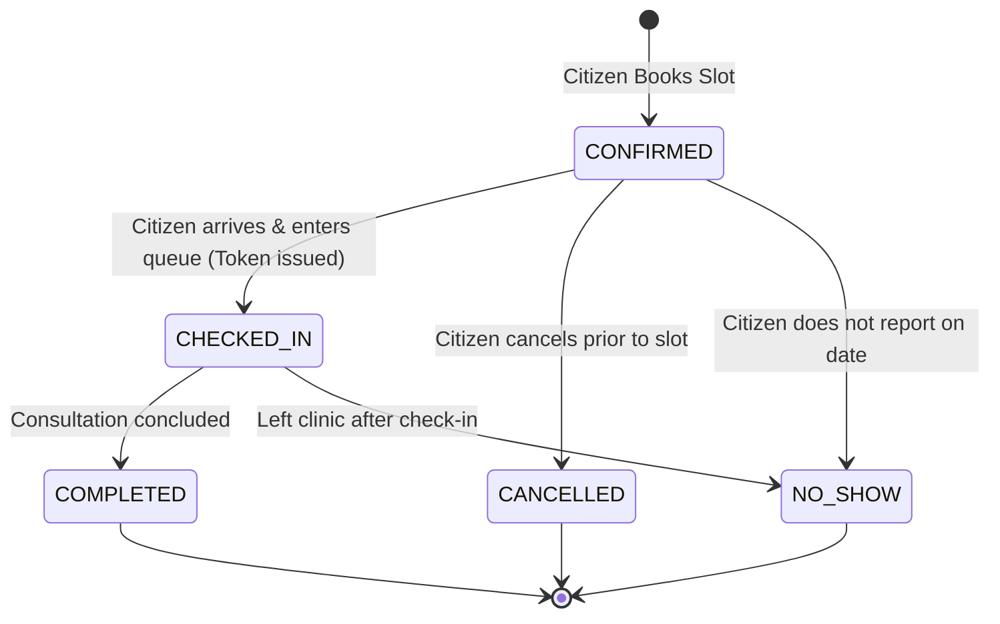

# QueueVista – Database Design & Entity-Relationship (ER) Specification

This document details the relational database design for **QueueVista**, a digital queue and appointment visibility platform for healthcare clinics, banks, and government service centers.

---

## 1. Design Choices & Viva Highlights

> **Third-Year CSE Viva Friendly Explanation:**
> 
> 1. **Why PostgreSQL?**  
>    PostgreSQL provides strict ACID compliance, robust indexing (`btree`, composite indexes), native support for `TIMESTAMPTZ` (time-zone aware timestamps), and check constraints that enforce data integrity directly at the database engine level.
> 
> 2. **Primary Keys (`BIGSERIAL` / `BIGINT`):**  
>    We use auto-incrementing 64-bit integers (`BIGSERIAL`) as primary keys for optimal indexing speed, predictable sequencing, and direct mapping to Spring Data JPA `GenerationType.IDENTITY`.
> 
> 3. **Avoiding Circular Foreign Keys between `users` and `counters`:**  
>    Instead of having `users.assigned_counter_id` point to `counters` while `counters.staff_id` points to `users` (which creates a chicken-and-egg insertion deadlock), we put `staff_id` exclusively on `counters` with a `UNIQUE` constraint. This cleanly ensures a staff member can only operate at most one counter at a time.
> 
> 4. **Why Dynamic Position instead of a static `position` column?**  
>    Storing a fixed `position` column in `queue_entries` would require updating hundreds of rows every time a customer is called, skips, or cancels (an $O(N)$ write penalty). Instead, position is calculated dynamically at query time (`ROW_NUMBER() OVER (...)` or filtered counts), ensuring zero lock contention and immediate consistency.
> 
> 5. **Daily Token Resets via `entry_date`:**  
>    By including `entry_date DATE DEFAULT CURRENT_DATE` alongside `daily_sequence INT`, token counters naturally reset to 101 every morning without requiring any scheduled cron job or nightly database reset script.
> 
> 6. **Why No Extra Tables (e.g., separate Activity Log table)?**  
>    Recent dashboard activities and queue analytics are directly derivable from state changes and timestamps in `queue_entries` and `appointments` (`joined_at`, `called_at`, `served_at`, `completed_at`). This avoids redundant denormalization and synchronization bugs while keeping the design easy to present and defend.

---

## 2. Mermaid Entity-Relationship Diagram

```mermaid
erDiagram
    ORGANIZATIONS ||--o{ USERS : "employs (staff/admin)"
    ORGANIZATIONS ||--o{ SERVICES : "offers"
    ORGANIZATIONS ||--o{ COUNTERS : "operates"
    SERVICES ||--o{ COUNTERS : "handled_by"
    USERS ||--o| COUNTERS : "operates"
    USERS ||--o{ QUEUE_ENTRIES : "joins"
    SERVICES ||--o{ QUEUE_ENTRIES : "queues_for"
    COUNTERS ||--o{ QUEUE_ENTRIES : "serves"
    USERS ||--o{ APPOINTMENTS : "books"
    SERVICES ||--o{ APPOINTMENTS : "scheduled_at"
    APPOINTMENTS ||--o| QUEUE_ENTRIES : "generates"
    USERS ||--o{ NOTIFICATIONS : "receives"

    ORGANIZATIONS {
        bigint id PK
        varchar name
        varchar category
        text address
        varchar phone
        varchar operating_hours
        timestamptz created_at
        timestamptz updated_at
    }

    USERS {
        bigint id PK
        bigint organization_id FK "nullable (null for general citizens)"
        varchar full_name
        varchar email UK
        varchar phone
        varchar password_hash
        varchar role "USER | STAFF | ADMIN"
        varchar status "ACTIVE | INACTIVE"
        timestamptz last_active_at
        timestamptz created_at
        timestamptz updated_at
    }

    SERVICES {
        bigint id PK
        bigint organization_id FK
        varchar name
        text description
        varchar token_prefix "e.g. D, B, V"
        int average_service_time_minutes
        boolean priority_enabled
        int max_queue_size
        varchar operating_hours
        varchar status "ACTIVE | INACTIVE"
        timestamptz created_at
        timestamptz updated_at
    }

    COUNTERS {
        bigint id PK
        bigint organization_id FK
        bigint service_id FK
        bigint staff_id FK_UK "nullable, 1-to-1 active staff"
        int counter_number
        varchar name
        varchar status "ACTIVE | IDLE | CLOSED"
        timestamptz created_at
        timestamptz updated_at
    }

    APPOINTMENTS {
        bigint id PK
        varchar appointment_code UK "e.g. A-201"
        bigint organization_id FK
        bigint service_id FK
        bigint user_id FK
        date appointment_date
        varchar time_slot "e.g. 10:30 AM"
        varchar status "CONFIRMED | CHECKED_IN | COMPLETED | CANCELLED | NO_SHOW"
        text notes
        timestamptz created_at
        timestamptz updated_at
    }

    QUEUE_ENTRIES {
        bigint id PK
        bigint organization_id FK
        bigint service_id FK
        bigint user_id FK
        bigint counter_id FK "nullable until called"
        bigint appointment_id FK_UK "nullable (linked if booked)"
        varchar token_number "e.g. D-108"
        int daily_sequence "e.g. 108"
        date entry_date "default CURRENT_DATE"
        varchar type "WALK_IN | APPOINTMENT"
        varchar priority "NORMAL | HIGH"
        varchar status "WAITING | CALLED | SERVING | COMPLETED | SKIPPED | CANCELLED | NO_SHOW"
        timestamptz joined_at
        timestamptz called_at
        timestamptz served_at
        timestamptz completed_at
        timestamptz created_at
        timestamptz updated_at
    }

    NOTIFICATIONS {
        bigint id PK
        bigint user_id FK
        varchar title
        text message
        varchar type "INFO | QUEUE_UPDATE | APPOINTMENT | ALERT"
        boolean is_read
        varchar link
        timestamptz created_at
    }
```

---

## 3. Table-by-Table Data Dictionary

### 3.1 `organizations`
Represents physical entities such as a clinic, bank branch, or regional transport office.

| Column | Data Type | Constraints / Rules | Description |
|---|---|---|---|
| `id` | `BIGSERIAL` | **PK**, `NOT NULL` | Unique internal organization identifier |
| `name` | `VARCHAR(150)` | `NOT NULL` | Branch name (e.g. "City Care Clinic") |
| `category` | `VARCHAR(50)` | `NOT NULL` | Domain: 'Healthcare', 'Banking', 'Government', 'Utility' |
| `address` | `TEXT` | `NOT NULL` | Full physical address |
| `phone` | `VARCHAR(30)` | `NOT NULL` | Contact telephone number |
| `operating_hours` | `VARCHAR(100)` | `NOT NULL` | Standard operating hours (e.g. '08:00 AM - 08:00 PM') |
| `created_at` | `TIMESTAMPTZ` | `NOT NULL`, `DEFAULT CURRENT_TIMESTAMP` | Record creation timestamp |
| `updated_at` | `TIMESTAMPTZ` | `NOT NULL`, `DEFAULT CURRENT_TIMESTAMP` | Last updated timestamp |

---

### 3.2 `users`
Represents citizens/patients (`USER`), counter operators (`STAFF`), and managers/supervisors (`ADMIN`).

| Column | Data Type | Constraints / Rules | Description |
|---|---|---|---|
| `id` | `BIGSERIAL` | **PK**, `NOT NULL` | Unique internal user identifier |
| `organization_id` | `BIGINT` | **FK** `-> organizations(id)`, `NULLABLE` | `NULL` for public citizens; set for staff/admin |
| `full_name` | `VARCHAR(100)` | `NOT NULL` | Full name of the individual |
| `email` | `VARCHAR(120)` | `NOT NULL`, **UNIQUE** | User login email address |
| `phone` | `VARCHAR(30)` | `NOT NULL` | User contact phone number for SMS/updates |
| `password_hash` | `VARCHAR(255)` | `NOT NULL` | BCrypt password hash for Spring Security |
| `role` | `VARCHAR(20)` | `NOT NULL`, `DEFAULT 'USER'`, `CHECK (role IN ('USER', 'STAFF', 'ADMIN'))` | Role-based authorization principal |
| `status` | `VARCHAR(20)` | `NOT NULL`, `DEFAULT 'ACTIVE'`, `CHECK (status IN ('ACTIVE', 'INACTIVE'))` | Account status |
| `last_active_at` | `TIMESTAMPTZ` | `NULLABLE` | Timestamp of last user heartbeat or login |
| `created_at` | `TIMESTAMPTZ` | `NOT NULL`, `DEFAULT CURRENT_TIMESTAMP` | Registration timestamp |
| `updated_at` | `TIMESTAMPTZ` | `NOT NULL`, `DEFAULT CURRENT_TIMESTAMP` | Profile update timestamp |

---

### 3.3 `services`
Represents specific service departments offered by an organization (e.g., General Consultation, Cash Deposit, Billing).

| Column | Data Type | Constraints / Rules | Description |
|---|---|---|---|
| `id` | `BIGSERIAL` | **PK**, `NOT NULL` | Unique service identifier |
| `organization_id` | `BIGINT` | **FK** `-> organizations(id)`, `NOT NULL` | Owning organization |
| `name` | `VARCHAR(100)` | `NOT NULL` | Name of service (e.g. "General Consultation") |
| `description` | `TEXT` | `NULLABLE` | Explanatory description of what the service covers |
| `token_prefix` | `VARCHAR(5)` | `NOT NULL` | 1-3 letter prefix for tickets (e.g. 'D', 'B', 'V') |
| `average_service_time_minutes` | `INT` | `NOT NULL`, `DEFAULT 15`, `CHECK (> 0)` | Expected duration per client used for wait estimates |
| `priority_enabled` | `BOOLEAN` | `NOT NULL`, `DEFAULT TRUE` | Whether emergency or appointment priority is supported |
| `max_queue_size` | `INT` | `NOT NULL`, `DEFAULT 50`, `CHECK (> 0)` | Daily or active cap on tickets to prevent overload |
| `operating_hours` | `VARCHAR(100)` | `NOT NULL` | Service-specific working hours (e.g. '08:00 AM - 02:00 PM') |
| `status` | `VARCHAR(20)` | `NOT NULL`, `DEFAULT 'ACTIVE'`, `CHECK (status IN ('ACTIVE', 'INACTIVE'))` | Operational status of the service |
| `created_at` | `TIMESTAMPTZ` | `NOT NULL`, `DEFAULT CURRENT_TIMESTAMP` | Record creation timestamp |
| `updated_at` | `TIMESTAMPTZ` | `NOT NULL`, `DEFAULT CURRENT_TIMESTAMP` | Last updated timestamp |

* **Unique Constraints:**
  - `(organization_id, name)`: Service names must be unique within an organization.
  - `(organization_id, token_prefix)`: Token prefixes cannot collide within the same organization.

---

### 3.4 `counters`
Represents physical service stations (booths, desks, teller windows) within an organization.

| Column | Data Type | Constraints / Rules | Description |
|---|---|---|---|
| `id` | `BIGSERIAL` | **PK**, `NOT NULL` | Unique counter identifier |
| `organization_id` | `BIGINT` | **FK** `-> organizations(id)`, `NOT NULL` | Organization where the counter exists |
| `service_id` | `BIGINT` | **FK** `-> services(id)`, `NOT NULL` | The service currently assigned to this counter |
| `staff_id` | `BIGINT` | **FK** `-> users(id)`, **UNIQUE**, `NULLABLE` | Staff currently operating the counter (1-to-1) |
| `counter_number` | `INT` | `NOT NULL`, `CHECK (counter_number > 0)` | Display number (e.g. 1 for Counter 1) |
| `name` | `VARCHAR(50)` | `NOT NULL` | Human-readable name (e.g. "Counter 2", "Window B") |
| `status` | `VARCHAR(20)` | `NOT NULL`, `DEFAULT 'IDLE'`, `CHECK (status IN ('ACTIVE', 'IDLE', 'CLOSED'))` | Current counter status |
| `created_at` | `TIMESTAMPTZ` | `NOT NULL`, `DEFAULT CURRENT_TIMESTAMP` | Creation timestamp |
| `updated_at` | `TIMESTAMPTZ` | `NOT NULL`, `DEFAULT CURRENT_TIMESTAMP` | Status change timestamp |

* **Unique Constraints:**
  - `(organization_id, counter_number)`: Counter numbers are unique per organization.
  - `(staff_id)`: Prevents the same staff user from being assigned to multiple active counters.

---

### 3.5 `appointments`
Represents pre-booked future reservations scheduled by citizens.

| Column | Data Type | Constraints / Rules | Description |
|---|---|---|---|
| `id` | `BIGSERIAL` | **PK**, `NOT NULL` | Unique appointment identifier |
| `appointment_code` | `VARCHAR(30)` | `NOT NULL`, **UNIQUE** | User-facing booking reference (e.g. "A-201") |
| `organization_id` | `BIGINT` | **FK** `-> organizations(id)`, `NOT NULL` | Organization where appointment is scheduled |
| `service_id` | `BIGINT` | **FK** `-> services(id)`, `NOT NULL` | Targeted service department |
| `user_id` | `BIGINT` | **FK** `-> users(id)`, `NOT NULL` | Citizen booking the appointment |
| `appointment_date` | `DATE` | `NOT NULL` | Date of the scheduled slot (e.g. '2026-10-26') |
| `time_slot` | `VARCHAR(20)` | `NOT NULL` | Time interval (e.g. '10:30 AM') |
| `status` | `VARCHAR(20)` | `NOT NULL`, `DEFAULT 'CONFIRMED'`, `CHECK (status IN ('CONFIRMED', 'CHECKED_IN', 'COMPLETED', 'CANCELLED', 'NO_SHOW'))` | Booking lifecycle status |
| `notes` | `TEXT` | `NULLABLE` | Optional patient remarks or appointment notes |
| `created_at` | `TIMESTAMPTZ` | `NOT NULL`, `DEFAULT CURRENT_TIMESTAMP` | Time of booking |
| `updated_at` | `TIMESTAMPTZ` | `NOT NULL`, `DEFAULT CURRENT_TIMESTAMP` | Status change timestamp |

* **Unique Constraints:**
  - `(service_id, appointment_date, time_slot)`: Prevents slot double-booking for the same service.

---

### 3.6 `queue_entries`
The core transactional ledger tracking real-time tokens in the digital line.

| Column | Data Type | Constraints / Rules | Description |
|---|---|---|---|
| `id` | `BIGSERIAL` | **PK**, `NOT NULL` | Unique queue entry identifier |
| `organization_id` | `BIGINT` | **FK** `-> organizations(id)`, `NOT NULL` | Organization managing the queue |
| `service_id` | `BIGINT` | **FK** `-> services(id)`, `NOT NULL` | Service queue joined |
| `user_id` | `BIGINT` | **FK** `-> users(id)`, `NOT NULL` | User holding the token |
| `counter_id` | `BIGINT` | **FK** `-> counters(id)`, `NULLABLE` | Counter serving this token once called |
| `appointment_id` | `BIGINT` | **FK** `-> appointments(id)`, **UNIQUE**, `NULLABLE` | Linked appointment ID if checked in from booking |
| `token_number` | `VARCHAR(20)` | `NOT NULL` | Formatted customer token (e.g. "D-108") |
| `daily_sequence` | `INT` | `NOT NULL`, `CHECK (daily_sequence > 0)` | Numeric daily counter (e.g. 108) |
| `entry_date` | `DATE` | `NOT NULL`, `DEFAULT CURRENT_DATE` | Calendar day of ticket issuance |
| `type` | `VARCHAR(20)` | `NOT NULL`, `DEFAULT 'WALK_IN'`, `CHECK (type IN ('WALK_IN', 'APPOINTMENT'))` | Source of token |
| `priority` | `VARCHAR(20)` | `NOT NULL`, `DEFAULT 'NORMAL'`, `CHECK (priority IN ('NORMAL', 'HIGH'))` | Priority weight for sorting line |
| `status` | `VARCHAR(20)` | `NOT NULL`, `DEFAULT 'WAITING'`, `CHECK (status IN ('WAITING', 'CALLED', 'SERVING', 'COMPLETED', 'SKIPPED', 'CANCELLED', 'NO_SHOW'))` | Live status |
| `joined_at` | `TIMESTAMPTZ` | `NOT NULL`, `DEFAULT CURRENT_TIMESTAMP` | Time citizen joined queue |
| `called_at` | `TIMESTAMPTZ` | `NULLABLE` | Time staff clicked "Next / Call" |
| `served_at` | `TIMESTAMPTZ` | `NULLABLE` | Time citizen reached counter & service began |
| `completed_at` | `TIMESTAMPTZ` | `NULLABLE` | Time interaction concluded |
| `created_at` | `TIMESTAMPTZ` | `NOT NULL`, `DEFAULT CURRENT_TIMESTAMP` | Row creation timestamp |
| `updated_at` | `TIMESTAMPTZ` | `NOT NULL`, `DEFAULT CURRENT_TIMESTAMP` | Row update timestamp |

* **Unique Constraints:**
  - `(service_id, entry_date, daily_sequence)`: Enforces unique monotonic sequence per service per day.
  - `(service_id, entry_date, token_number)`: Guarantees no two active or past tokens on the same day share a token string.

---

### 3.7 `notifications`
System alerts, status changes, and reminders sent to users.

| Column | Data Type | Constraints / Rules | Description |
|---|---|---|---|
| `id` | `BIGSERIAL` | **PK**, `NOT NULL` | Unique notification identifier |
| `user_id` | `BIGINT` | **FK** `-> users(id)`, `NOT NULL` | Recipient user |
| `title` | `VARCHAR(150)` | `NOT NULL` | Brief alert header (e.g. "Token Generated") |
| `message` | `TEXT` | `NOT NULL` | Full alert message body |
| `type` | `VARCHAR(30)` | `NOT NULL`, `DEFAULT 'INFO'`, `CHECK (type IN ('INFO', 'QUEUE_UPDATE', 'APPOINTMENT', 'ALERT'))` | Categorical notification type |
| `is_read` | `BOOLEAN` | `NOT NULL`, `DEFAULT FALSE` | Status flag for unread badge counters |
| `link` | `VARCHAR(255)` | `NULLABLE` | Deep-link target route (e.g. '/user/queue/D-108') |
| `created_at` | `TIMESTAMPTZ` | `NOT NULL`, `DEFAULT CURRENT_TIMESTAMP` | Time notification was generated |

---

## 4. Relationship Analysis & Cardinality

1. **`organizations` to `users` (One-to-Many, Optional):**  
   An organization employs many staff members and administrators. Public citizens (`role = 'USER'`) have `organization_id = NULL` because they are clients who can visit any registered clinic or bank.

2. **`organizations` to `services` (One-to-Many, Mandatory):**  
   An organization offers one or more distinct services (e.g., City Care Clinic offers General Consultation, Billing, and Verification). If an organization is deleted, its services cascade delete.

3. **`organizations` to `counters` (One-to-Many, Mandatory):**  
   An organization operates multiple physical counters/windows (Counter 1, Counter 2, etc.).

4. **`services` to `counters` (One-to-Many):**  
   Each counter is configured to serve a specific service department (`service_id`). Multiple counters can serve the same high-volume service simultaneously (e.g. Counters 1 and 2 can both serve General Consultation).

5. **`users` (Staff) to `counters` (One-to-One / Zero-to-One):**  
   A counter can be manned by at most one staff user at a time via `counters.staff_id UNIQUE`. When a counter is idle or closed, `staff_id` is `NULL`.

6. **`users` to `queue_entries` (One-to-Many):**  
   A user can enter queues multiple times over time (e.g., past consultations and current queues).

7. **`services` to `queue_entries` (One-to-Many):**  
   A service handles hundreds of queue entries across days.

8. **`counters` to `queue_entries` (One-to-Many, Optional):**  
   While waiting in line, a queue entry has `counter_id = NULL`. When a staff member at Counter 2 calls the token, `counter_id` is linked to Counter 2.

9. **`appointments` to `queue_entries` (Zero-to-One / One-to-One):**  
   When a patient with an appointment arrives and completes check-in, an active token is generated with `appointment_id` pointing to their appointment. Walk-in tokens have `appointment_id = NULL`.

10. **`users` to `appointments` (One-to-Many):**  
    A citizen can schedule multiple appointments across different dates and services.

11. **`services` to `appointments` (One-to-Many):**  
    A service receives appointment reservations for specific date/time slots.

12. **`users` to `notifications` (One-to-Many):**  
    Each user has an inbox of real-time notification alerts.

---

## 5. Token Generation Algorithm (Prefix + Daily Sequence)

### Format: `<PREFIX>-<NUMBER>` (e.g. `D-108`)

1. **Prefix Determination:**
   - Every service has a unique `token_prefix` column (e.g., `'D'` for Doctor / General Consultation, `'B'` for Billing Counter, `'V'` for Document Verification).
   - This allows users and staff on LED displays and mobile screens to immediately recognize the target department.

2. **Daily Sequence Reset (Starting at 101):**
   - In physical queues, starting at `101` rather than `1` prevents confusion with single-digit counter numbers (e.g., token 2 called at counter 3).
   - When a user joins a queue on date `entry_date = CURRENT_DATE`:
     ```sql
     SELECT COALESCE(MAX(daily_sequence), 100) + 1
     FROM queue_entries
     WHERE service_id = :serviceId
       AND entry_date = CURRENT_DATE;
     ```
   - If no tokens have been generated today for this service, `MAX` returns `NULL`, `COALESCE` defaults to `100`, and the first token becomes `101`.
   - The token string is assembled: `token_number = prefix || '-' || next_sequence` (e.g., `D` + `-` + `101` = `D-101`).

3. **Why this design is viva-proof:**
   - **No Midnight Cron Jobs:** Because queries filter on `entry_date = CURRENT_DATE`, the counter naturally restarts at 101 each morning at 00:00:00 without needing scheduled triggers.
   - **Concurrency Safety:** In Spring Data JPA, token generation can execute inside a serializable/repeatable transaction with a database unique constraint `uq_queue_service_date_seq (service_id, entry_date, daily_sequence)`. Any collision retry guarantees strictly sequential tokens.

---

## 6. State Machine & Status Lifecycles

### 6.1 Queue Entry Status Lifecycle



- **WAITING:** Token created, waiting in line.
- **CALLED:** Staff member triggers buzzer/announcement; token flashes on display screen.
- **SERVING:** Citizen arrives at the desk and transaction is underway.
- **COMPLETED:** Staff finishes consultation/service.
- **SKIPPED:** Citizen did not immediately respond; staff moves to next token while allowing skipped token to be recalled later.
- **CANCELLED:** Citizen voluntarily leaves queue from their mobile dashboard.
- **NO_SHOW:** Citizen permanently missed their turn.

---

### 6.2 Appointment Status Lifecycle



- **CONFIRMED:** Slot reserved in the database.
- **CHECKED_IN:** Patient arrives at clinic, checks in, and a priority queue token (e.g., `D-106`) is issued.
- **COMPLETED:** Consultation concluded at the counter.
- **CANCELLED:** Appointment cancelled by citizen or clinic admin.
- **NO_SHOW:** Patient never checked in on the scheduled appointment date.

---

## 7. Schema File Reference

The complete executable PostgreSQL DDL script is located in:
**[`docs/schema.sql`](file:///c:/Users/user/Desktop/queuevista/docs/schema.sql)**

The script includes all `CREATE TABLE` statements, primary keys, foreign key constraints with `ON DELETE` rules, unique constraints, domain `CHECK` constraints, and performance indexes for rapid lookups.
